# Undergraduate Research：HybridHQ — 季節別の短期電力需要予測のための、時間・変数ハイブリッド Transformer

**論文**：Reona Mizutani, Nico Surantha, "A FiLM-Based Hybrid Temporal–Variable Transformer for Season-Specific Short-Term Load Forecasting," PREE 2026（東京都市大学）

- **作成者**：Reona Mizutani（水谷）　GitHub：[MIZUTANI-re](https://github.com/MIZUTANI-re)
- **所属**：Tokyo City University（東京都市大学）
- **位置づけ**：学部の研究（Undergraduate Research）として取り組んだ電力需要予測の研究です。

このリポジトリは、上の論文で用いたコード・データ・確定値（論文の表の数値）をまとめたものです。

---

## 1. 結論

- 提案モデル **HybridHQ** は、比較した 4 モデルの中で **5 つのデータセット（春・夏・秋・冬・通年）すべてで MAPE が最も低い** 結果になりました。
- RMSE でも、需要の変動が大きい **夏・秋・冬で最も低く** なりました。春と通年の RMSE は iTransformer とほぼ同じです（通年 14.657 対 14.613、差は seed 間のばらつきより小さい）。
- iTransformer と比べた MAPE の改善は、夏 約 11.2%、秋 約 11.1%、冬 約 10.6% です。LSTM と比べると、通年で RMSE を約 11.4%、MAPE を約 17.8% 下げました。
- アブレーション（部品を外す比較）では、**24 本の Horizon Query（予測時刻ごとの学習可能な問い合わせ）が最も一貫して精度に効いて** いました。FiLM と線形残差の効果はデータセットによって異なります。

| | 春 | 夏 | 秋 | 冬 | 通年 |
|---|---|---|---|---|---|
| HybridHQ の MAPE（%） | **2.769** | **3.611** | **3.115** | **4.235** | **3.193** |
| 2 番目に良いモデルの MAPE（%） | 2.815（iTransformer） | 4.068（iTransformer） | 3.503（iTransformer） | 4.737（iTransformer） | 3.269（iTransformer） |

---

## 2. 背景と目的

日本の電力小売市場では、小売電気事業者が需要と調達の計画を前もって作り、計画と実績の差はインバランスとして精算されます。そのため、翌日の需要を正確に予測することは、経済性と安定運用の両方に重要です。

電力需要は季節によって形が大きく変わります。夏は冷房による昼間の高い需要、冬は暖房による朝と夕方の 2 つのピーク、春と秋は穏やかな形です。本研究では、季節ごとのデータセットと通年のデータセットの両方で、次の 2 つの見方を組み合わせたモデルを評価しました。

- **時間の見方**：過去の時刻どうしの関係（Transformer）
- **変数の見方**：需要・気象・カレンダーの変数どうしの関係（iTransformer）

---

## 3. データ

| 項目 | 内容 |
|---|---|
| 予測対象 | 四国エリアの 1 時間ごとの電力需要（四国電力送配電の需給実績。単位 10⁴ kW のまま使用） |
| 気象 | 気象庁の観測値（香川・徳島・愛媛・高知を集約）：気温・降水量・日射 |
| カレンダー | 時刻・日・曜日・月・休日・祝日 |
| 期間 | 2016-04-01 〜 2024-02-29 |
| 入力 → 出力 | 直近 72 時間 → 次の 24 時間を一度に予測 |
| 分割 | 時系列順に学習 80% / 検証 10% / テスト 10%（正規化は学習区間だけで決める） |

**Table I　データセットごとのサンプル数**

| データセット | 期間 | サンプル数 |
|---|---|---:|
| 春 | 3 月 1 日〜5 月 31 日 | 16,920 |
| 夏 | 6 月 1 日〜8 月 31 日 | 17,664 |
| 秋 | 9 月 1 日〜11 月 30 日 | 17,472 |
| 冬 | 12 月 1 日〜2 月 29 日 | 17,328 |
| 通年 | 全期間 | 69,384 |

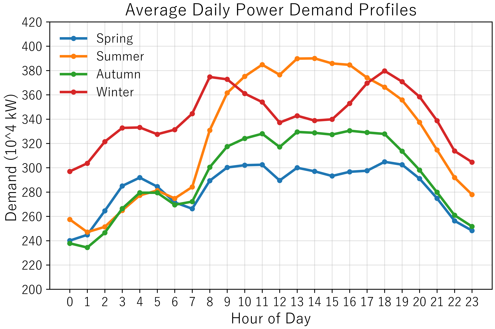

### データの出どころと作り方

`data/` の CSV は、すべて公開データから作っています。どの列がどこから来て、どう加工したかを下に示します。需要とカレンダーと季節分割は、`data_preparation/` のスクリプトで公開データと照合できます。

| 列 | 意味 | 出どころ | 加工 |
|---|---|---|---|
| `datetime`・`time` | 日付と時刻（0〜23 時） | 四国電力送配電「エリア需給実績」 | 年度別 Excel の DATE・TIME 列 |
| `power_demand` | エリア需要（10⁴ kW） | 同上の「エリア需要」列 | **そのまま**（単位も変えていない） |
| `temperature` | 気温（℃） | 気象庁「過去の気象データ・ダウンロード」 | 香川・徳島・愛媛・高知の観測地点の平均 |
| `precipitation` | 降水量（mm） | 同上 | 同上 |
| `solar_mean` | 日射量（MJ/m²） | 同上 | 日射を観測している 3 地点の平均 |
| `weekday` | 曜日（月曜 0 〜 日曜 6） | 日付 | 日付から計算 |
| `restday` | 土曜・日曜なら 1 | 日付 | 日付から計算 |
| `holiday_onehot` | 土曜・日曜・祝日（振替休日を含む）なら 1 | 内閣府「国民の祝日」CSV | 日付と祝日の表から計算 |

- **季節別の 4 ファイル** は、通年のファイルを月で分けたものです（春 3〜5 月、夏 6〜8 月、秋 9〜11 月、冬 12〜2 月）。`data_preparation/split_seasons.py` で作り直せます。
- モデルの中では、さらに「日」と「曜日・月の one-hot」を作り、気象・カレンダーと合わせて入力にしています（各モデルの `prepare_data`）。
- **気象の 3 列だけは、自動では作り直せません。** 気象庁のサイトは画面から地点と項目を選んで取得する方式で、そのとき取得したファイルと集計の作業記録が残っていないためです。値の範囲と欠けがないことは確認しています。

公開データと照合する手順（四国電力送配電と内閣府のファイルを `data/raw/` に取得してから確かめる。`data/raw/` は git に入れない）:

```bash
python data_preparation/sources.py
```

```bash
python data_preparation/verify_dataset.py
```

照合の結果（2026-10-31 に実行）:

| 確認 | 結果 | 内容 |
|---|---|---|
| 形（期間・0〜23 時・欠けなし） | OK | 69,384 行、2016-04-01〜2024-02-29 |
| 需要 ＝ 四国電力送配電のエリア需要 | OK | 69,384 / 69,384 行が一致 |
| カレンダーの列 ＝ 日付と内閣府の祝日から作った値 | OK | weekday・restday・holiday_onehot とも 69,384 行一致 |
| 季節分割（春・夏・秋・冬） | OK | 4 ファイルとも完全に一致。行数は Table I と同じ |
| 気象（欠けなし・値の範囲） | OK | 気温 −2.5〜35.8 ℃、降水量 0〜26.25 mm、日射 0〜3.70 |

### データと処理の関係（ER 図）

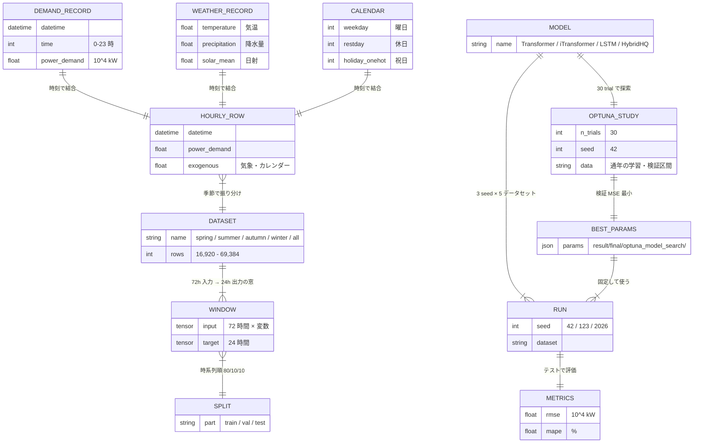

---

## 4. モデル

4 つのモデルは、同じ入力（72 時間）・同じ出力（24 時間）・同じ評価で比べています。

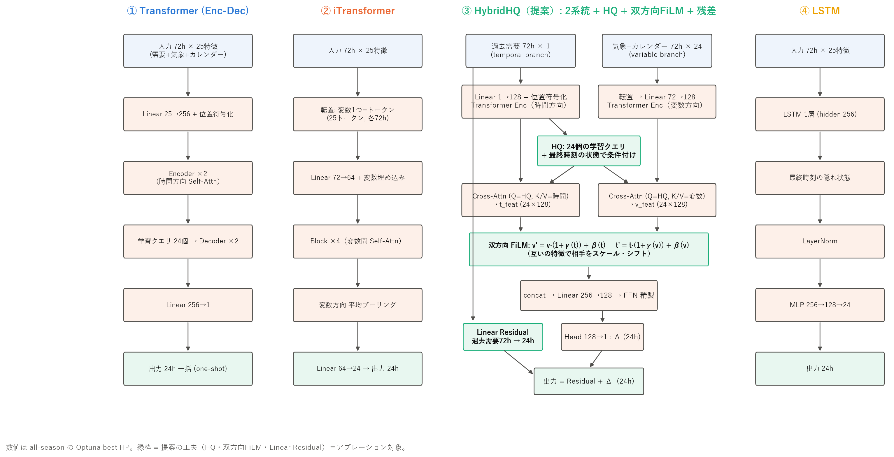

### 4-1. Transformer（時間の見方）

各時刻を 1 つのトークンにして、self-attention で時刻どうしの関係をとらえます。72 時間の中のどの 2 時刻も直接関係づけられます。

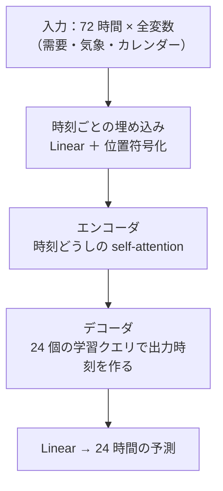

### 4-2. iTransformer（変数の見方）

入力を転置し、**変数 1 つの 72 時間全体を 1 つのトークン** にします。attention は「どの変数どうしが関係しているか」を表します。

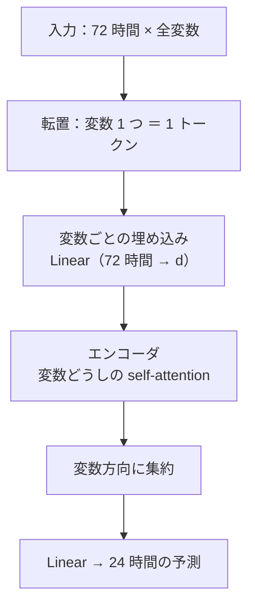

### 4-3. LSTM（比較の基準）

72 時間を順番に読み、最後の時刻の隠れ状態から 24 時間をまとめて出します。24 時間すべてが 1 つの共有された表現から作られます。

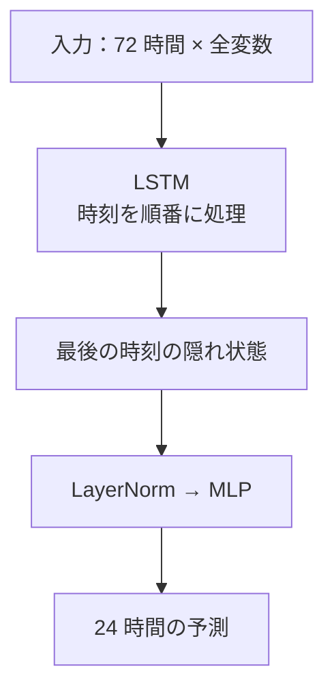

### 4-4. HybridHQ（提案）

時間の見方と変数の見方を 2 つのブランチで別々に作り、**24 本の Horizon Query** で「予測時刻ごとに必要な情報」を両方から取り出します。

- **時間ブランチ**：過去需要の 72 時間を時刻ごとのトークンにして、時刻どうしの関係を学ぶ（式 1）。
- **変数ブランチ**：気象・カレンダーの各変数をトークンにして、変数どうしの関係を学ぶ（式 2）。
- **Horizon Query（HQ）**：予測する 24 時間それぞれに 1 本ずつ、学習で決まる問い合わせベクトルを持つ。時間ブランチの最後の状態から作った条件を全 query に足したうえで、2 つのブランチに cross-attention する（式 3）。朝の立ち上がりと昼のピークで必要な情報が違う、という問題に対応する。
- **双方向 FiLM**：時間側の特徴で変数側を、変数側の特徴で時間側を、倍率と足し込みで調整する（式 4・5）。
- **線形残差**：過去需要 72 時間から次の 24 時間への線形の経路を並列に足し、需要の水準と傾向を保つ（式 6）。

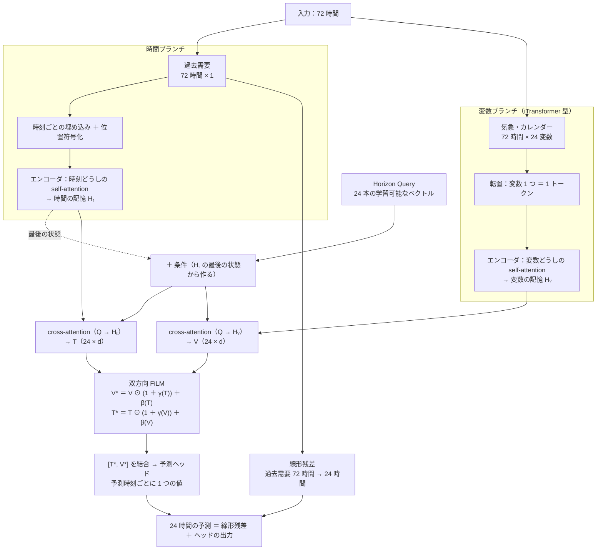

**Table II　HybridHQ の設定**（通年データ・30 trial の Optuna・seed 42 で選択）

| 項目 | 値 | 項目 | 値 |
|---|---|---|---|
| d_model | 128 | 層数 | 1 |
| attention head | 4 | hidden 次元 | 1024 |
| dropout | 0.0366 | 学習率 | 3.293 × 10⁻⁵ |
| batch | 128 | 最適化 | AdamW |
| weight decay | 2.054 × 10⁻⁴ | 勾配クリップ | 1 |
| 系列の扱い | warm | HQ の条件づけ | shared |
| FiLM の活性化 | tanh | 線形残差 | あり |

---

## 5. 実験の条件

すべてのモデルを **同じ予算** でハイパーパラメータ探索し、公平に比べています。

**Table III　共通の実験設定**

| 項目 | 値 |
|---|---|
| 入力 / 出力 | 72 時間 / 24 時間 |
| 分割 | 時系列順 80/10/10（strict warm） |
| 探索に使うデータ / seed | 通年 / 42 |
| Optuna の予算 | 各モデル 30 trial |
| 選択の基準 | 検証データの MSE |
| 最終評価の seed | 42, 123, 2026 |
| テストデータを探索に使うか | 使わない |

各モデルが通年データの探索で選んだ HP を、4 つの季節別データセットにもそのまま使っています。評価は RMSE（10⁴ kW）と MAPE（%）で、3 seed の平均 ± 標本標準偏差を示します。

**各モデルが選んだ HP**（`result/final/optuna_model_search/`）

| モデル | 構造 | 学習 |
|---|---|---|
| Transformer | d_model 256・head 16・エンコーダ 2 層・デコーダ 2 層・FFN 1024 | 学習率 2.74 × 10⁻⁵、batch 32、dropout 0.018、Adam |
| iTransformer | d_model 64・head 8・4 層・hidden 512 | 学習率 2.76 × 10⁻⁴、batch 64、dropout 0.088、AdamW |
| LSTM | hidden 256・1 層・出力層 128 | 学習率 2.61 × 10⁻⁴、batch 128、dropout 0.171、Adam |
| HybridHQ | Table II | Table II |

---

## 6. 結果

### 6-1. 予測精度（Table IV）

**Table IV　予測精度：RMSE（10⁴ kW）/ MAPE（%）（平均 ± 標準偏差、3 seed）**

| モデル | 指標 | 春 | 夏 | 秋 | 冬 | 通年 |
|---|---|---|---|---|---|---|
| Transformer | RMSE | 10.366 ± 0.437 | 19.926 ± 0.232 | 13.716 ± 0.801 | 19.977 ± 0.535 | 15.767 ± 0.222 |
| | MAPE | 2.952 ± 0.087 | 4.190 ± 0.089 | 3.544 ± 0.380 | 4.753 ± 0.096 | 3.492 ± 0.055 |
| iTransformer | RMSE | **9.703 ± 0.260** | 18.730 ± 0.706 | 12.726 ± 0.622 | 19.230 ± 0.381 | **14.613 ± 0.434** |
| | MAPE | 2.815 ± 0.047 | 4.068 ± 0.088 | 3.503 ± 0.287 | 4.737 ± 0.121 | 3.269 ± 0.062 |
| **HybridHQ** | RMSE | 10.024 ± 0.261 | **17.423 ± 0.217** | **12.156 ± 0.220** | **17.882 ± 0.388** | 14.657 ± 0.127 |
| | MAPE | **2.769 ± 0.059** | **3.611 ± 0.037** | **3.115 ± 0.029** | **4.235 ± 0.141** | **3.193 ± 0.034** |
| LSTM | RMSE | 10.945 ± 0.375 | 19.064 ± 0.180 | 13.130 ± 0.305 | 20.094 ± 0.358 | 16.541 ± 0.084 |
| | MAPE | 3.391 ± 0.111 | 4.383 ± 0.123 | 3.618 ± 0.085 | 4.856 ± 0.135 | 3.885 ± 0.026 |

太字は各列で最良の値です。

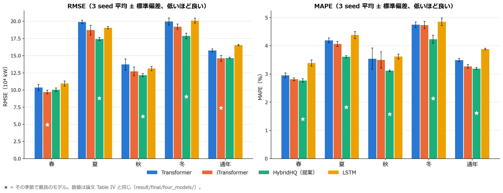

### 6-2. 夏と冬の予測の例

時間帯ごとの平均（3 seed）。夏は朝の立ち上がりと昼の高い需要、冬は朝と夕方の 2 つのピークを、HybridHQ が実績に近い形で追っています。

| 夏 | 冬 |
|---|---|
| 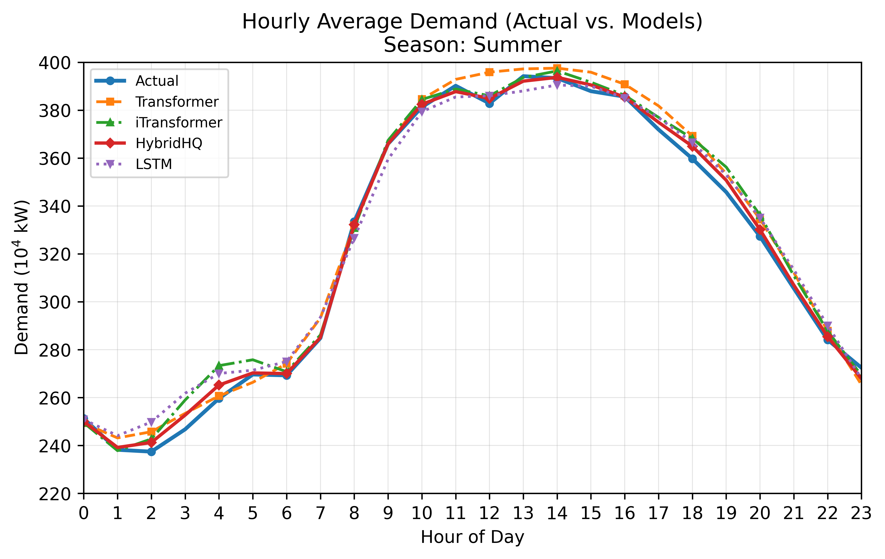 | 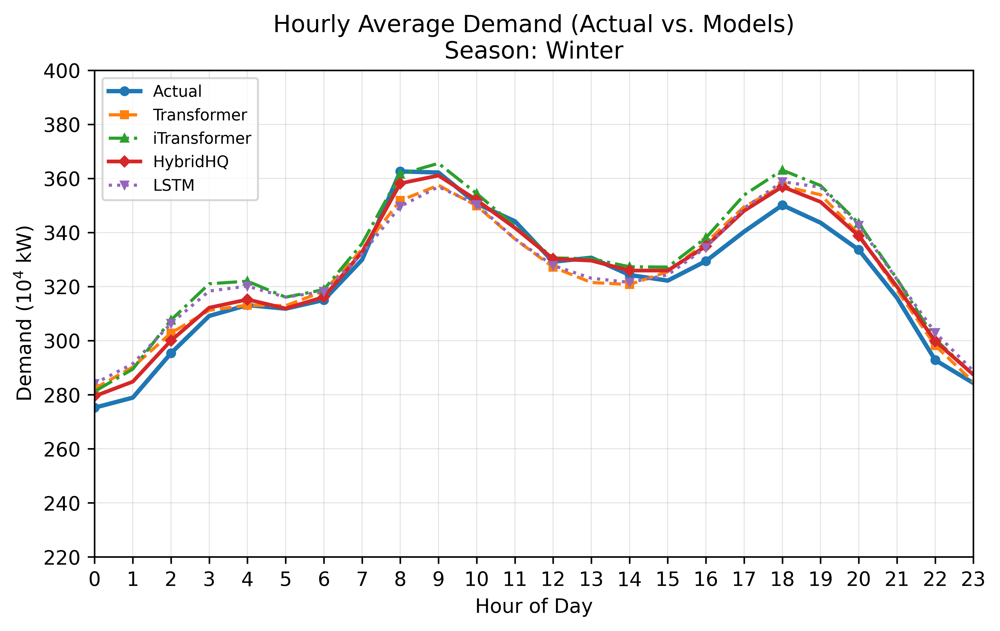 |

### 6-3. アブレーション（Table V）

HybridHQ の部品を 1 つずつ外した 4 条件を、それぞれ同じ 30 trial の予算で探索し直して比べました。

**Table V　アブレーション：RMSE（10⁴ kW）/ MAPE（%）（平均 ± 標準偏差、3 seed）**

| 条件 | 指標 | 春 | 夏 | 秋 | 冬 | 通年 |
|---|---|---|---|---|---|---|
| Full HybridHQ | RMSE | 10.024 ± 0.261 | 17.423 ± 0.217 | 12.156 ± 0.220 | 17.882 ± 0.388 | 14.657 ± 0.127 |
| | MAPE | 2.769 ± 0.059 | 3.611 ± 0.037 | 3.115 ± 0.029 | 4.235 ± 0.141 | 3.193 ± 0.034 |
| FiLM なし（単純結合） | RMSE | 9.512 ± 0.408 | 17.557 ± 0.484 | 11.685 ± 0.090 | 17.575 ± 0.562 | 14.839 ± 0.074 |
| | MAPE | 2.718 ± 0.162 | 3.524 ± 0.105 | 2.987 ± 0.020 | 4.124 ± 0.123 | 3.221 ± 0.014 |
| HQ なし | RMSE | 10.000 ± 0.545 | 19.016 ± 0.438 | 13.286 ± 0.419 | 18.703 ± 0.280 | 14.892 ± 0.070 |
| | MAPE | 2.898 ± 0.081 | 4.092 ± 0.193 | 3.617 ± 0.194 | 4.514 ± 0.118 | 3.325 ± 0.064 |
| 線形残差なし | RMSE | 9.582 ± 0.511 | 18.284 ± 0.696 | 12.297 ± 0.174 | 17.728 ± 0.709 | 15.262 ± 0.251 |
| | MAPE | 2.727 ± 0.084 | 3.686 ± 0.069 | 3.140 ± 0.040 | 4.148 ± 0.128 | 3.343 ± 0.113 |

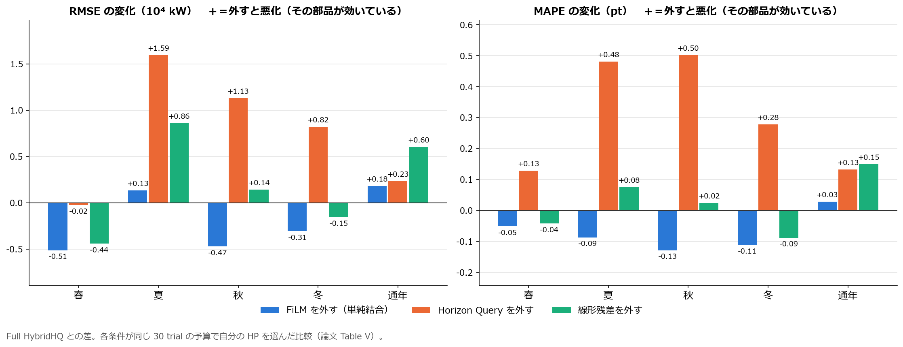

- **Horizon Query** を外すと、夏・秋・冬で RMSE が約 9.1%・9.3%・4.6%、MAPE が約 13.3%・16.1%・6.6% 悪化しました。通年でも RMSE 約 1.6%、MAPE 約 4.1% 悪化しています。部品の中で最も一貫して効いています。
- **FiLM** と **線形残差** の効果はデータセットによって異なりました。季節別のいくつかのデータでは、FiLM を単純な結合に置き換えたほうが良い結果でした。どちらも通年データと夏の RMSE で効果が大きく、「常に効く部品」ではなく「安定化のための仕組み」と位置づけています。

---

## 7. 考察と実務での使い方

- 24 時間の各時刻は、必要とする情報が違います。朝の立ち上がりは夜間の需要と気温、昼のピークは冷暖房の条件が効きます。Horizon Query は、予測時刻ごとに時間と変数の情報の組み合わせを選び直せるので、1 つの共有表現から 24 時間を作るモデルより、立ち上がりやピークの多い季節で差が出たと考えられます。
- 指標によって選ぶモデルは変わりえます。需要の高低にかかわらず相対的な精度をそろえたい場合（MAPE）は HybridHQ が適しています。誤差の絶対量が費用に直結する場合（RMSE）、春だけは iTransformer がわずかに有利です。
- 季節別モデルは季節ごとの形に特化できる一方で、切り替えのルールと追加の学習・保守が必要です。通年モデルは運用が簡単です。HybridHQ は通年データでも競争力のある結果を示しました。

## 8. 制約

- 対象は四国エリアと上記の期間に限られます。他のエリアや、分布が変わった状況での一般化は今後の課題です。
- アブレーションは「各条件が自分で HP を選ぶ同一予算の比較」で、HP を固定した 1 要因の比較ではありません。
- 3 seed の標準偏差は学習の安定性を示すもので、統計的な有意性は主張していません。
- インバランス費用などの金額の削減効果は直接計算していません。

---

## 9. 再現方法

### 環境

```bash
pip install -r requirements.txt
```

動作を確認した環境：Python 3.12.4、PyTorch 2.5.1（CUDA 12.1）、Optuna 4.6.0、pandas 2.3.3、NumPy 2.3.4、scikit-learn 1.7.2、Matplotlib 3.10.7、SciPy 1.16.2。GPU は NVIDIA RTX A6000 で実行しました。

### 手順

1. ハイパーパラメータを探索する（任意。探索済みの値はスクリプトに書き込み済み）

```bash
python optuna/model_search/Optuna_search_3models_all_seed42_equal_budget.py
```

```bash
python optuna/model_search/LSTM_optuna_multiseed_all_seasons.py
```

2. 4 モデルを 3 seed × 5 データセットで学習・評価する（出力：`result/result_csv/`）

```bash
python models/transformer/TransformerFixed_multiseed_OptunaHP_final.py
```

```bash
python models/itransformer/iTransformer_multiseed_OptunaHP_final.py
```

```bash
python models/lstm/LSTM_multiseed_OptunaHP_final.py
```

```bash
python models/hybrid/HybridHQ_multiseed_OptunaHP_final.py
```

3. Table IV の形にまとめる

```bash
python analysis/compare_four_models_multiseed.py
```

4. アブレーション（Table V）

```bash
python optuna/ablation/run_all_ablation_optuna.py
```

```bash
python optuna/ablation/run_ablation_final_test_and_compare.py
```

5. 図を作る

```bash
python analysis/plot_final_summer_winter.py
```

```bash
python analysis/make_readme_figures.py
```

論文の確定値は `result/final/` にあります。再実行した結果はこれと比べられます（GPU の非決定性により、小数点以下の細かい値はわずかに変わることがあります）。

---

## 10. フォルダ構成

| フォルダ | 中身 |
|---|---|
| `data/` | 需要・気象・カレンダーの CSV（通年 1 つ ＋ 季節別 4 つ） |
| `data_preparation/` | 公開データの取得（`sources.py`）、カレンダーの作り方（`make_calendar.py`）、季節分割（`split_seasons.py`）、公開データとの照合（`verify_dataset.py`） |
| `models/` | 4 モデルの学習・評価スクリプト（論文で使った版） |
| `optuna/model_search/` | 同一予算のハイパーパラメータ探索 |
| `optuna/ablation/` | アブレーション（4 条件の探索と最終評価） |
| `analysis/` | 表と図を作るスクリプト |
| `result/final/` | **論文の確定値**（Table IV・V の CSV、Optuna の記録、論文の図） |
| `figures/` | この README の図 |

## 11. 出典

- 電力需要：四国電力送配電「エリア需給実績」 https://www.yonden.co.jp/nw/supply_demand/data_download.html （利用条件 https://www.yonden.co.jp/nw/supply_demand/site_info.html ）
- 気象：気象庁「過去の気象データ・ダウンロード」 https://www.data.jma.go.jp/risk/obsdl/
- 祝日：内閣府「国民の祝日について」 https://www8.cao.go.jp/chosei/shukujitsu/gaiyou.html
- 比較モデル：Transformer（Vaswani et al., 2017）、iTransformer（Liu et al., ICLR 2024）、FiLM（Perez et al., AAAI 2018）、Optuna（Akiba et al., KDD 2019）

## 著者

- Reona Mizutani（Tokyo City University, Graduate School of Integrative Science and Engineering, Dept. of Electrical Engineering and Chemistry）
- Nico Surantha（Tokyo City University, Faculty of Science and Engineering, Dept. of Electrical, Electronics, and Communication Engineering）
